# Overlook for Home Assistant

Four Home Assistant dashboards sharing one design language, generated from Python
and deployed over the websocket API.

| dashboard | shape | built for |
|---|---|---|
| `kitchen` | fixed panel, no scrolling | 1024x600 wall display (Nest Hub) |
| `phone` | single column, room sections | handheld |
| `tablet` | control centre, rail + room switcher | iPad, both orientations |
| `computer` | whole house at once, 4 columns | 1920x1080 and 1440x900 laptops |

Flat, borderless cards; tints derived from an accent with `color-mix()` so light and
dark both work from one definition; detail lives in pop-ups rather than dropdowns.

## What they look like

### Computer — the whole house, no scrolling
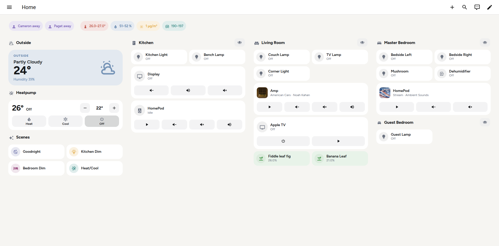

### Kitchen — fixed 1024x600 wall panel
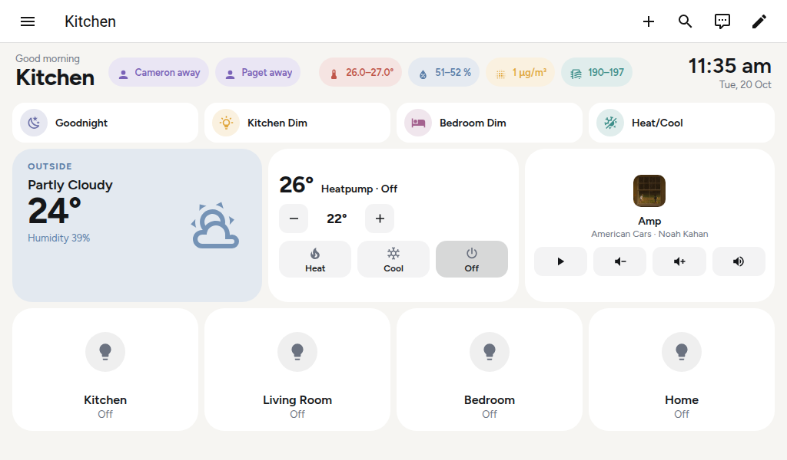

### Tablet — control centre with a room switcher
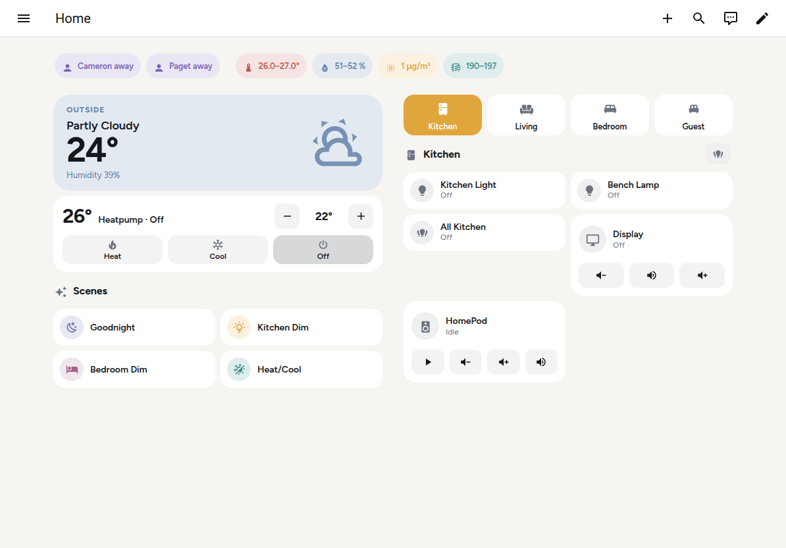

### Phone — light and dark
<p>
  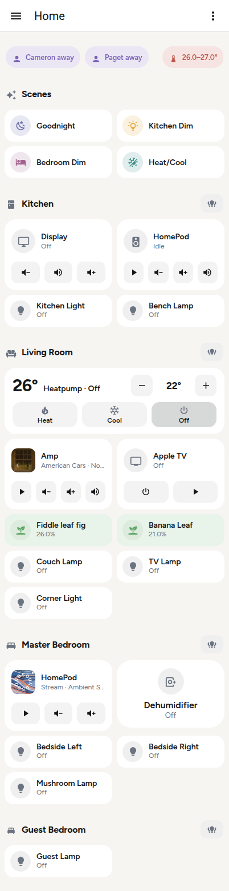
  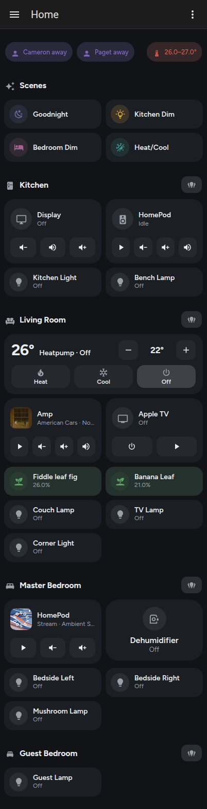
</p>

Dark mode is not a second palette: surfaces come from the theme's own CSS variables
and every tint is `color-mix()`'d against whatever surface is current.

### Pop-ups — where the detail lives

`button-card` cannot draw a dropdown, a slider or a stepper, so anything that needs
one taps through to a Bubble Card pop-up. There are 23. A tile shows the current
value; the pop-up holds the controls.

<p>
  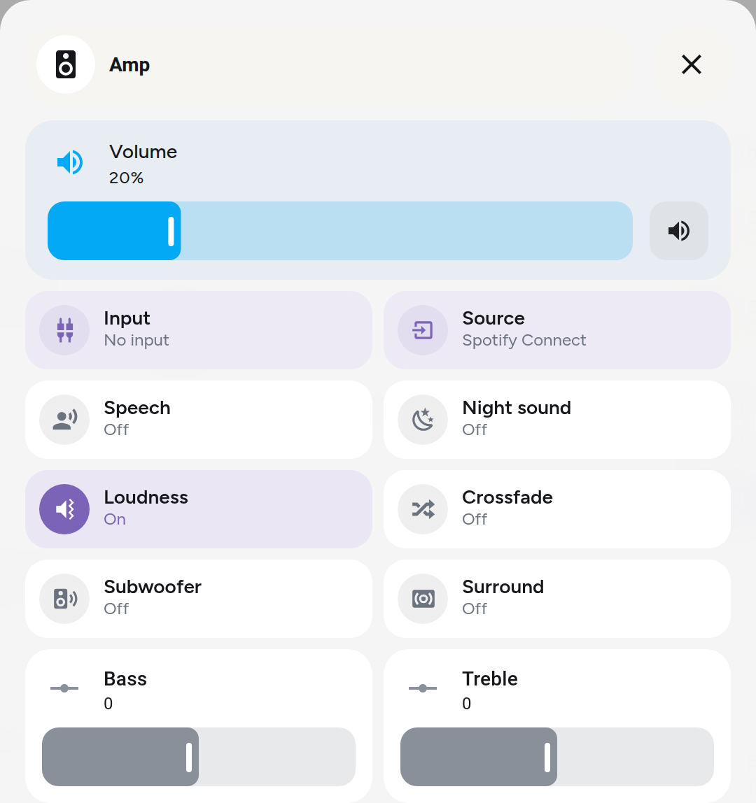
  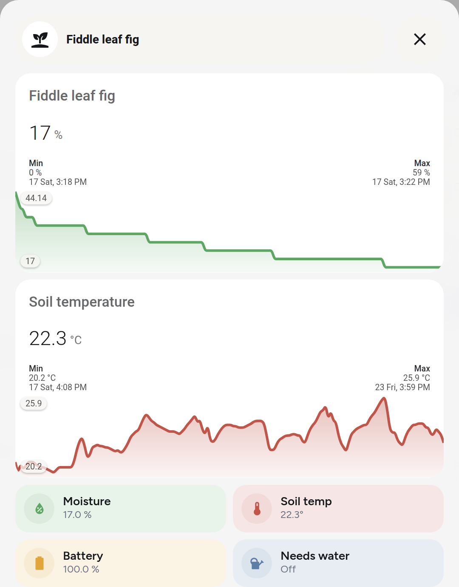
</p>

**Amp** is the one that drove most of the styling work. The volume row tints blue and
turns red when muted, the mute button darkening with it. `Input` and `Source` are
button-cards that open a second pop-up — pop-ups can open from inside pop-ups. The
`Bass` and `Treble` sliders are native `tile` cards wrapped in a button-card with
`--ha-card-background: transparent`, which is how a native control sits flush on a
tint. **Plant** pairs two `mini-graph-card`s with the current readings underneath.

<p>
  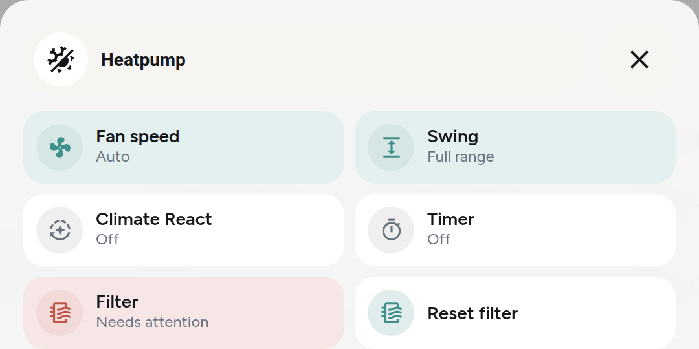
  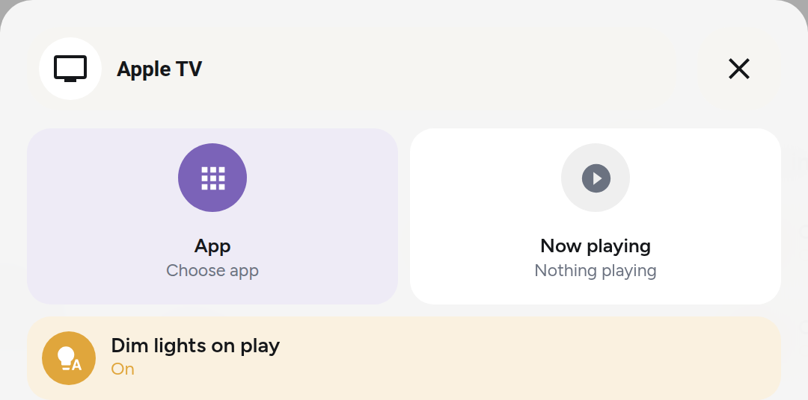
</p>

**Heatpump** keeps fan speed and swing as tiles that open their own option pickers,
and `Filter` turns red on its own when it needs attention. **Apple TV** is a
two-high half-width now-playing card next to the app picker; the transport buttons
were deliberately removed.

<p>
  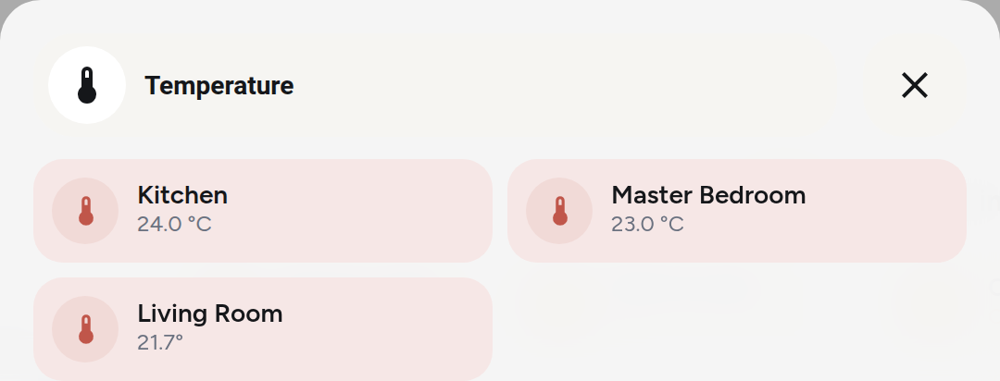
  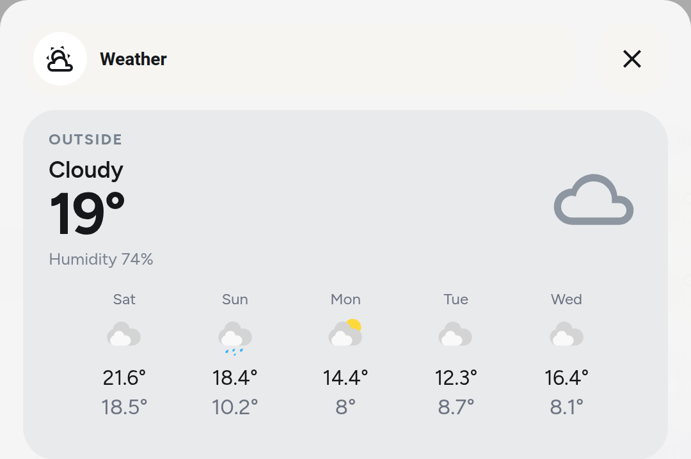
</p>

**Temperature** is the pattern behind the top strip: the pill shows the range across
the house, and tapping it breaks the range out per room. Living Room reads `21.7°`
without a unit because it is sourced from a climate entity's
`current_temperature` attribute rather than a sensor — forcing a `°C` fallback made
VOC render as "18–26°", so the fallback is empty on purpose. **Weather** carries the
five-day forecast as a native card.

## Why it is generated rather than hand-written YAML

Each dashboard is ~60-280 KB of JSON. The cards are near-identical with different
entities, and a change to, say, the tile height has to land in ~90 places. `design.py`
holds the card builders; the dashboard modules are thin layouts over it.

## Requirements

- Home Assistant **2026.10** or similar
- [`custom:button-card`](https://github.com/custom-cards/button-card) — every card
- [`Bubble Card`](https://github.com/Clooos/Bubble-Card) — the pop-ups
- A theme named `Overlook` (any theme works; the dashboards only rely on standard
  HA CSS variables). Ours is in [`themes/overlook.yaml`](themes/overlook.yaml):
  copy it to `/config/themes/overlook/`, call `frontend.reload_themes`, then
  `frontend.set_theme` with `name: Overlook` to make it the app-wide default.
  **A theme needs both `modes.light` and `modes.dark`.** With only `dark`, HA
  forces dark mode on every device, whatever the device is set to.
- A long-lived access token at `~/.config/ha/token`

**`card-mod` is deliberately not used.** On HA 2026.10 it loads, logs its banner and
injects no styles at all — see `design.py`. Everything here uses button-card's native
`styles`, which is why the code looks the way it does.

### Tablet Media tab

The tablet's fifth tab plays music through **Music Assistant**, not HA's Spotify
integration: Spotify's API cannot drive a Sonos, and HomePods only take AirPlay.
It needs the Music Assistant integration, an `input_select.tablet_speaker` helper
(options as in `tablet.SPEAKERS`), a `Media` option on `input_select.tablet_room`,
and the trigger-based template sensor in
[`ha_config/tablet_playlists.yaml`](ha_config/tablet_playlists.yaml) appended to
the `template:` list in `configuration.yaml`.

## Use

```sh
./deploy.py --list                 # what is on the box
./deploy.py kitchen computer       # rebuild those from the generators
./deploy.py --dry-run phone        # build and diff, write nothing
./deploy.py --patch phone          # patch the LIVE config, keep hand edits
```

`HA_HOST` and `HA_TOKEN_FILE` override the defaults.

### Deploy vs patch

Plain deploy **replaces** a dashboard. `--patch` reads what is live, swaps only the
cards it owns, and refuses to write if anything else moved. Use `--patch` for any
dashboard that has been edited in the HA UI — otherwise those edits are silently lost.

## Layout

```
design.py      the design language: every card builder, the palette, the colour logic
patch3.py      status pills, the 17 pop-ups, and the in-place patcher
patch.py       older single-purpose patcher, kept for reference
kitchen.py     \
phone.py        | one module per dashboard, thin layouts over design.py
tablet.py       |
computer.py    /
deploy.py      CLI
ha_ws.py       minimal websocket client (no websocket library needed)
tools/cdp.py   headless-browser driver used to verify renders
```

`tools/cdp.py` drives a headless Chromium over the DevTools protocol to check a
dashboard actually rendered — measuring card sizes, catching clipped labels, clicking
things and reading back the result. Screenshots alone repeatedly failed to catch
broken cards here.

## Sizing cards: use HA's own grid, not a wrapper

Home Assistant's sections view (`hui-grid-section`) is a **12-column grid of 56px
rows with an 8px gap**. Every card takes `grid_options`, and both axes are real:

```python
{"grid_options": {"columns": 6, "rows": 2}}   # half width, two rows tall
```

That matters because a grid row takes its height from the tallest card in it. A
media card here is a fixed 124px against a tile's 56, so a tile placed beside one
floats at the top of the row with ~68px of dead space underneath it.

The fix is `rows`, not a container. `columns: 6, rows: 2` spans the media card
over two rows — 56 + 8 + 56 = 120px — and tiles flow around it:

```
HomePod (6 wide, 2 rows)  |  Dehumidifier
                          |  Mushroom Lamp
Bedside Left (6)          |  Bedside Right (6)
```

**Every tile stays an independent card**, so they can still be dragged anywhere in
the HA UI and the grid re-packs them. A custom "stack two cards in one cell"
wrapper was written here first and then deleted: it filled the row, but it fused
the two tiles into a single card and they could no longer be moved apart. If a
layout needs cards of different heights to line up, reach for `rows` first — there
is almost certainly no need to build anything.

## Adapting it to another install

See **[AGENTS.md](AGENTS.md)** — a brief written for an LLM: what to change, what to
leave alone, how to verify, and the platform traps that are not obvious.
