# Meridian for Home Assistant

Echo Show-style Home Assistant dashboards, a matching theme and a set of phone cards.

- **Meridian cards**: tiles, room headings, scenes and status pills with pop-ups, set up in
  HA's own card editor. Installed from HA's marketplace (HACS). See [Install](#install-with-hacs).
- **The Show screens**: full-screen layouts for wall tablets, a Nest Hub and an Echo Show,
  deployed with `deploy.py`.
- **The Meridian theme** for HA's own pages.

Both come from one Lit source, [`www/overlook-show.js`](www/overlook-show.js), built twice: the
phone cards into `dist/meridian.js`, the Show screens into the card `deploy.py` ships. A few
Python files say which entities go where on each screen.

| dashboard | screen | layout |
|---|---|---|
| **Kitchen Show** `ha-show` | 8" kitchen tablet, 1280x800 | dock on the left, date, favourites, calendar and shopping list; idles to photos |
| **Hub Show** `ha-show-hub` | Nest Hub, 1024x600, cast | photos are home; Controls, Media, Climate, Calendar and Recipes behind the dock |
| **Bedroom Show** `ha-show-bedroom` | Echo Show 5, 960x480 | photos and a big clock, bedroom controls, red night clock, voice timers and alarms |
| **Computer Show** `ha-show-computer` | 1440x820 to 1920x950, beside HA's sidebar | the whole house on one page |
| **Phone Show** `ha-show-native` | 390 wide | ordinary HA sections built from Meridian cards, so HA's own editor works |

How to change and deploy them: **[docs/DASHBOARDS.md](docs/DASHBOARDS.md)**.
Working on this house's live install: [docs/LIVE.md](docs/LIVE.md).
Separately, [docs/ECHO_MUTE_BUTTON.md](docs/ECHO_MUTE_BUTTON.md) turns an Echo Show 5's top
button into a mute button.

**Type:** Amazon Ember Display (headings, clock, big numbers) and Amazon Ember (everything
else), the typefaces Echo devices use. The font files are not in this repo; see
[Fonts](#fonts) for how to get them. Weather icons are our own SVGs, drawn by
[`tools/weather_icons.py`](tools/weather_icons.py).

*Calendar entries, the shopping list and the photo in these screenshots are placeholders.*

## Kitchen Show
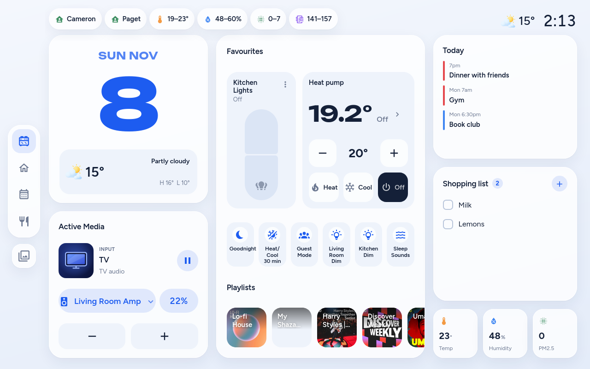
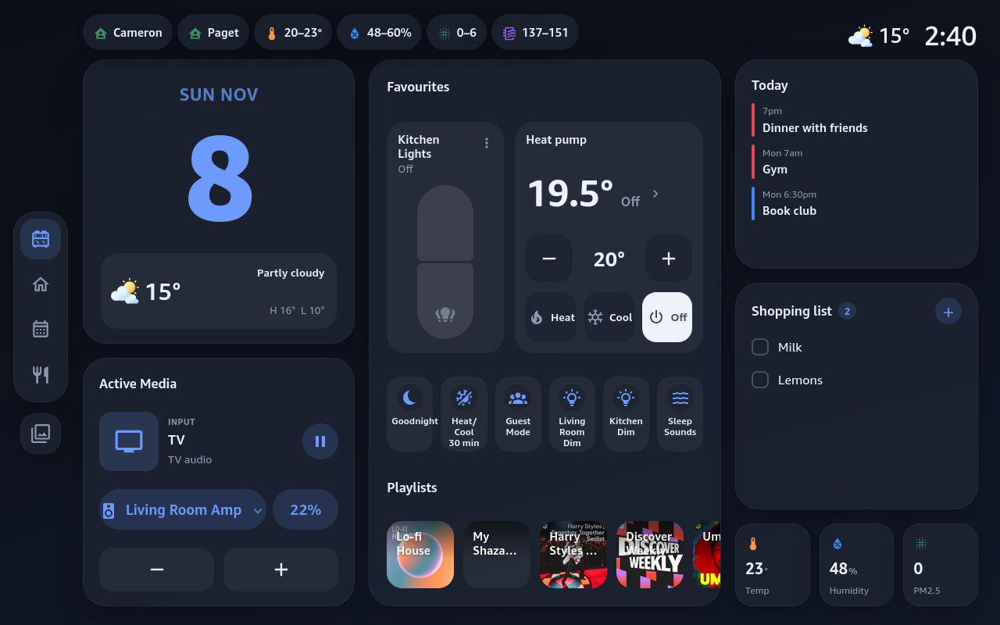

**Home** goes room by room, with lights as split pills you drag to dim. **Recipes** come from
Norish, synced into HA every 30 minutes.
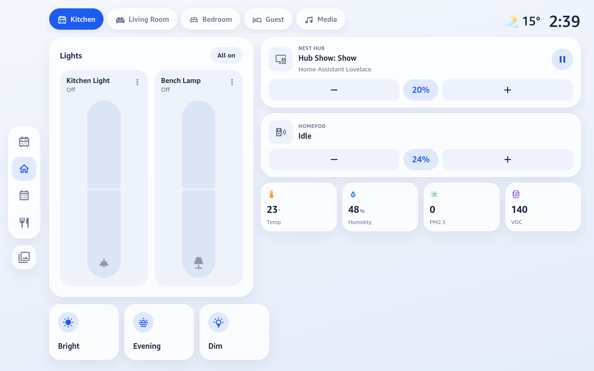
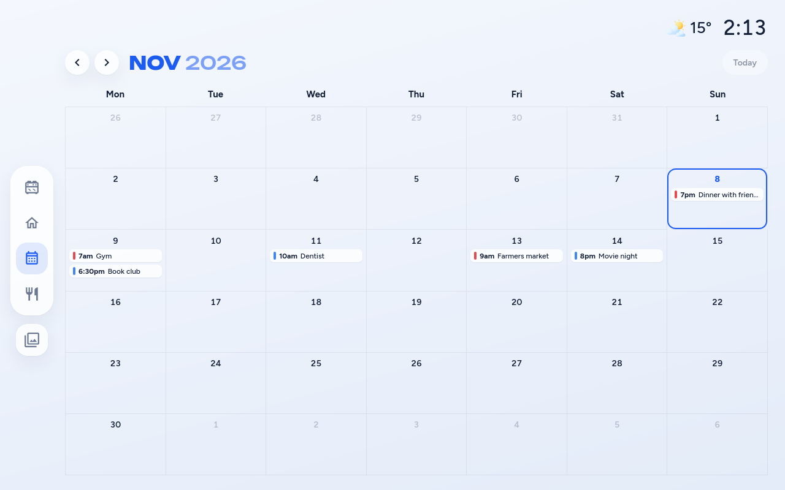
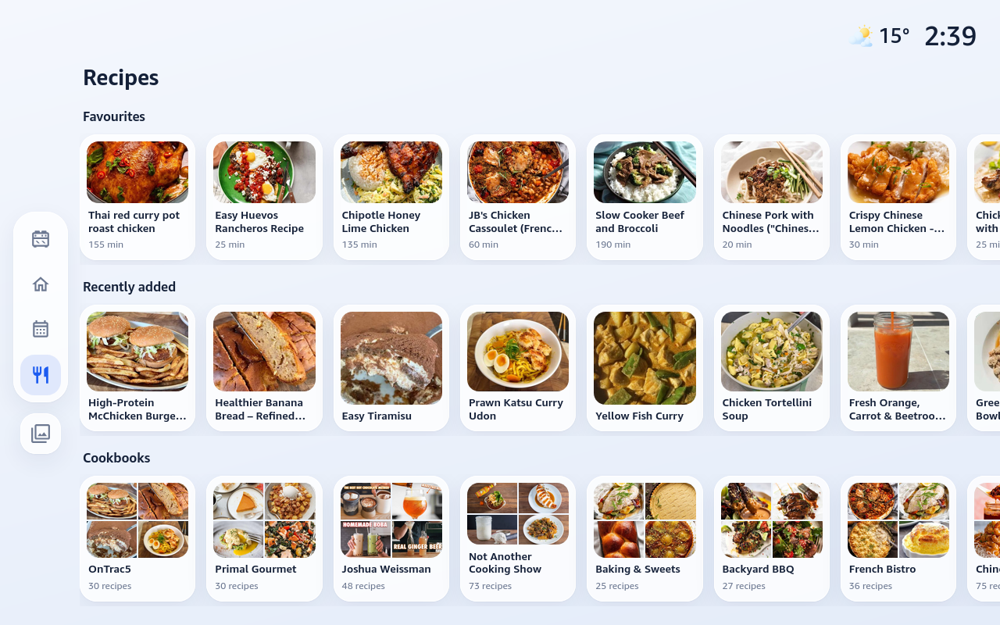

## Hub Show
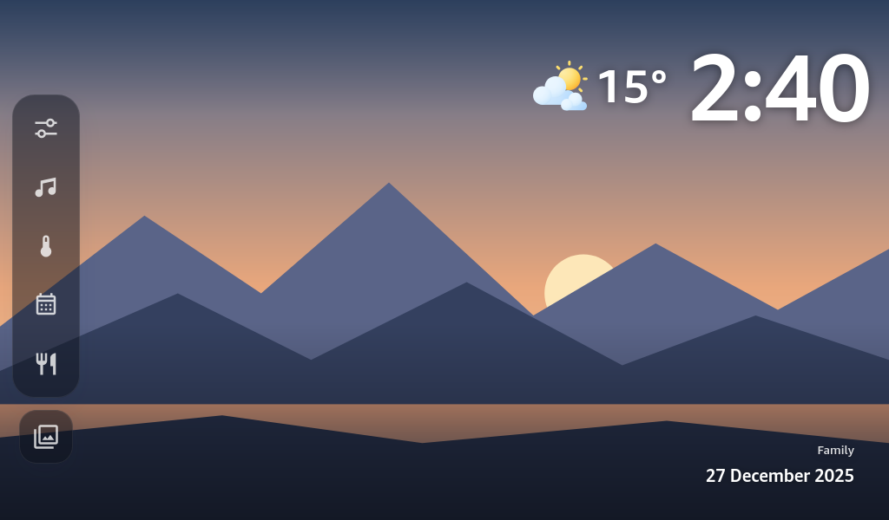
<p>
  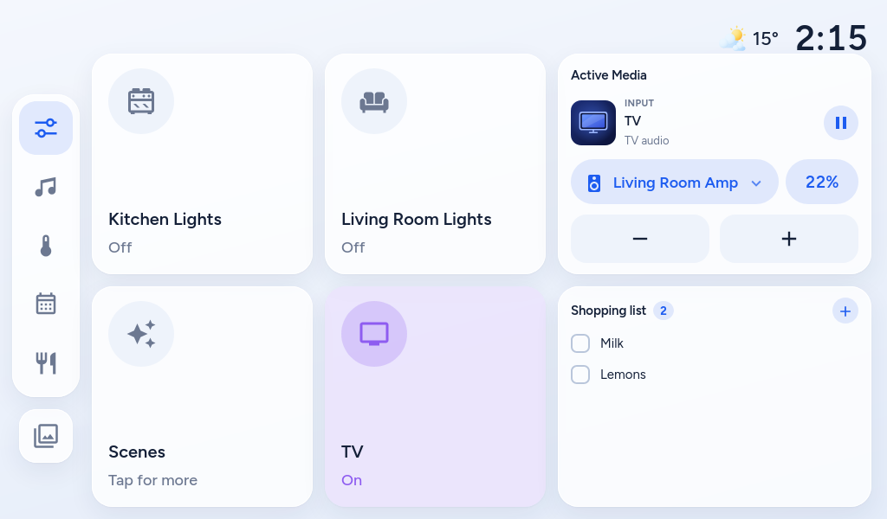
  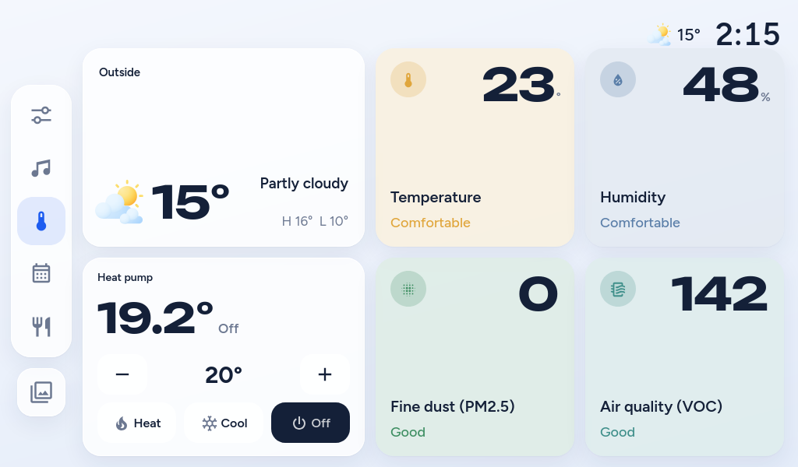
</p>

## Bedroom Show
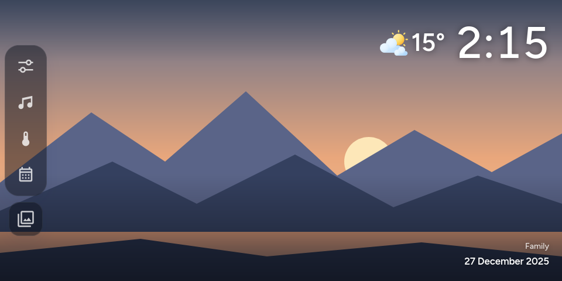
<p>
  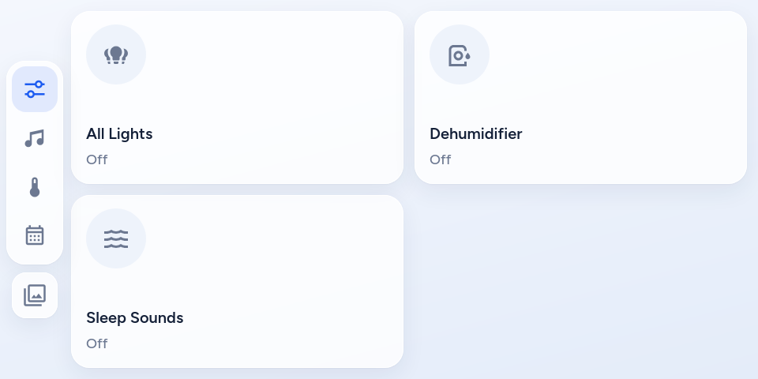
  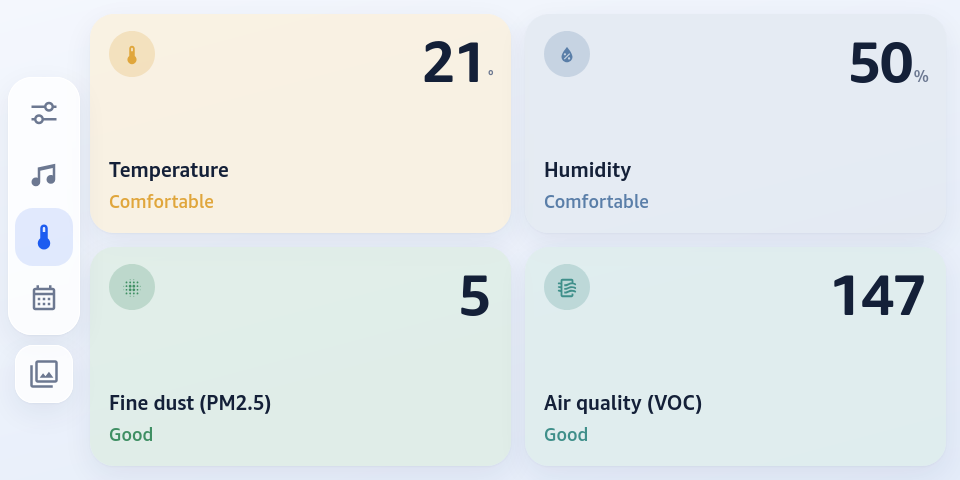
</p>

## Computer Show
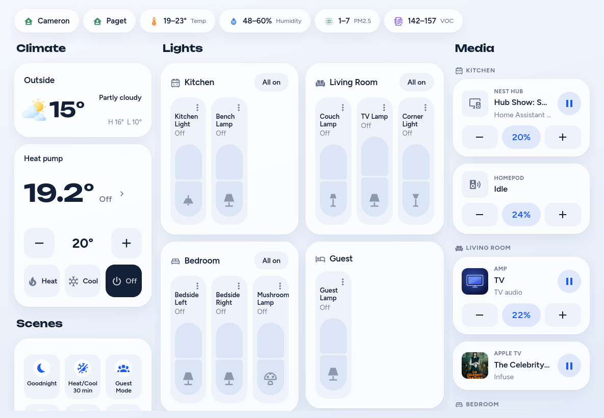
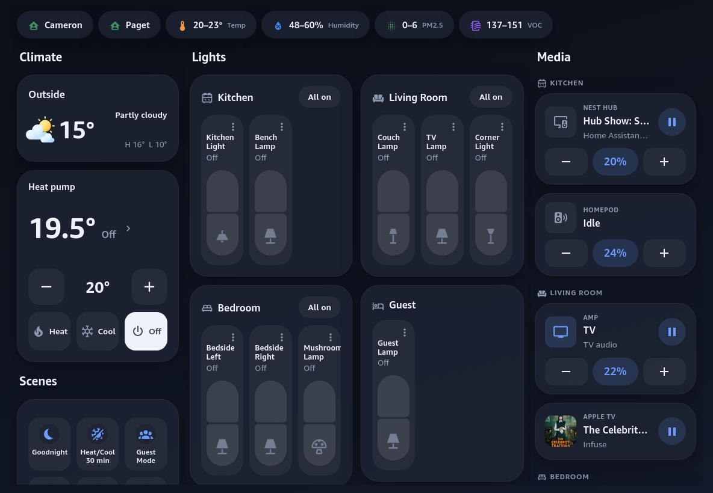

## Phone Show
<p>
  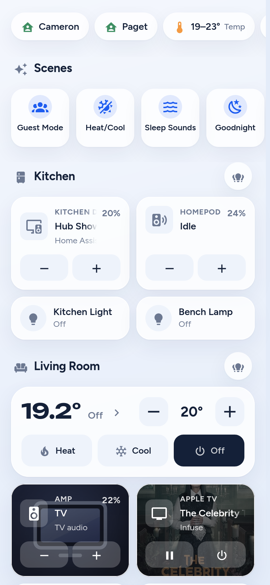
  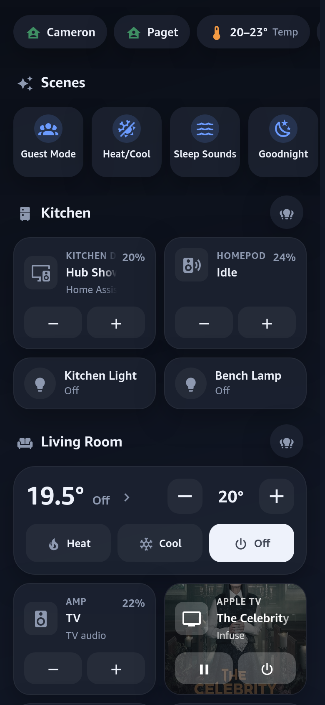
</p>

Tapping a speaker, plant, heat pump or status pill opens a bottom sheet:
<p>
  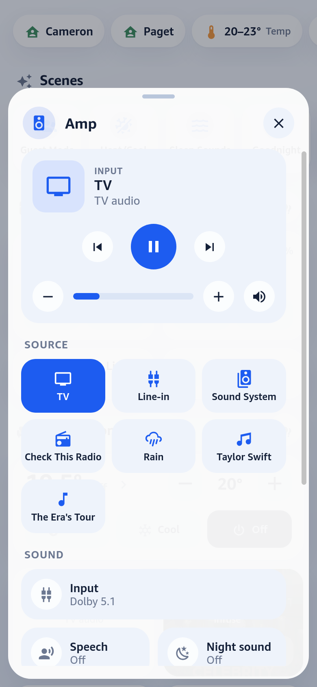
  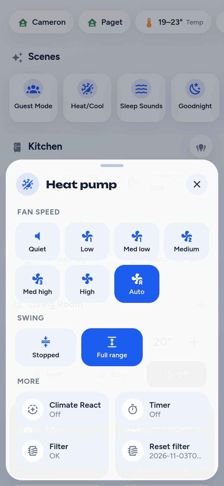
</p>

## Install with HACS

Meridian cards install on their own, with no deploy script. HACS is built into recent HA
releases as the marketplace; the steps are the same:

1. HACS (marketplace) → ⋮ → **Custom repositories** → add `https://github.com/Boldestfutura/meridian`, type **Dashboard**.
2. Install **Meridian cards**, then reload the browser.
3. On a sections dashboard, **+ Add card** → search "Meridian": tile, room heading, scenes,
   favourites, status and edit button. Every setting, pop-ups included, is in HA's card editor.

The big screen cards are the Show's pieces as cards of their own, so any sections dashboard
can use them, and a dashboard built from them is a Show screen without `deploy.py`:

| card | what it is |
|---|---|
| `meridian-large-button` | a big square that switches its entity; hold opens the light sheet or a pop-up |
| `meridian-large-sensor` | a big reading with its verdict word, tinted Auto or from a swatch row |
| `meridian-calendar` | views: date, date with weather, what's on, or the full month |
| `meridian-media` | what's playing, the speaker picker and volume, over the speakers you list |
| `meridian-playlists` | playlist tiles that play on the media card's speaker |
| `meridian-dock` | the Show's dock: one button per dashboard view, plus photos, night clock, voice timers and alarms, and full-screen now playing |

Put one `meridian-dock` on each view (a bare one copies the first configured one). The weather
icons in "date with weather" are served from `/local/weather/`, which `deploy.py` ships.

**Meridian favourites** needs no setup: it shows the controls each person uses most at this
time of day, as Home Assistant learns them (the `usage_prediction` integration, HA 2025.10 or
later, the same list as HA's own "Common controls"). Whatever is on goes first. Tap is the
quick control; hold opens the light sheet or the thing's pop-up. "Always show" and "Never show"
correct it.

HACS ships `dist/meridian.js` (Lit bundled in): the phone cards and the screen cards above.
The single full-screen `overlook-show` card is not in it; `deploy.py` builds and ships that one.
Cards first added as `custom:overlook-tile` (and the other `overlook-*` names) still work.
Amazon Ember is not included; without it the cards fall back to the system font.

## Requirements

- Home Assistant **2026.10** or similar. Lit is vendored in `www/`.
- SSH to the HA box (`deploy.py` copies the card to `/config/www` with `scp`) and a long-lived
  access token at `~/.config/ha/token`.
- Optional, per feature: `album_slideshow` cameras for the photos, Music Assistant for
  playlists (the template sensor in [`ha_config/tablet_playlists.yaml`](ha_config/tablet_playlists.yaml)),
  Norish for recipes (`tools/norish_sync.py`), a `todo` list and calendars.
- Amazon Ember, optional: see [Fonts](#fonts).
- The `Meridian` theme ([`themes/meridian.yaml`](themes/meridian.yaml)) for HA's own pages and
  the Phone Show's sections view. **A theme needs both `modes.light` and `modes.dark`**: with
  only `dark`, HA forces dark mode on every device.

## Fonts

The dashboards are set in **Amazon Ember**. Amazon owns it and publishes it on its
[Echo typography guidelines](https://developer.amazon.com/en-US/alexa/branding/echo-guidelines/identity-guidelines/typography)
page ("Download (font, 25 MB)"), so it isn't redistributed here. Without it the
dashboards still work and fall back to the system font.

To use it:

1. Download the font set from that page and unzip it. Inside is
   `amazon_typography_webfonts.zip`; unzip that too.
2. On the HA box, make `/config/www/fonts/amazon-ember/` and copy these into it:

   | file | from |
   |---|---|
   | `AmazonEmber_W_Rg.woff2`, `AmazonEmber_W_SBd.woff2`, `AmazonEmber_W_Bd.woff2`, `AmazonEmber_W_He.woff2` | `webfonts/` |
   | `AmazonEmberDisplay_W_Rg.woff2`, `AmazonEmberDisplay_W_Md.woff2`, `AmazonEmberDisplay_W_Bd.woff2`, `AmazonEmberDisplay_W_He.woff2` | `webfonts/` |
   | `Amazon-Ember-Medium.ttf`, renamed to `AmazonEmber_Md.ttf` | `Ember/` in the outer zip (the web set has no Medium) |

3. Run `./deploy.py` for any Show dashboard. It copies [`www/fonts/ember.css`](www/fonts/ember.css)
   beside them.
4. For HA's own pages and other cards, add `/local/fonts/amazon-ember/ember.css` as a
   Lovelace resource of type *Stylesheet* (Settings > Dashboards > Resources). The
   `Meridian` theme already names `Amazon Ember` as its font.

The card loads the files itself, through HA's absolute URL, so a Nest Hub cast gets them too.
HA's static files already allow `cast.home-assistant.io`, so nothing else is needed.

## Use

```sh
./deploy.py --list                       # what is on the box
./deploy.py show showhub showbedroom     # ship the card, save those dashboards
./deploy.py --dry-run showcomputer       # build and diff, write nothing
```

`HA_HOST` and `HA_TOKEN_FILE` override the defaults. Bump `VERSION` in both `show.py` and
`www/overlook-show.js` with every card change, or browsers keep the old one. `deploy.py` also
rebuilds `dist/meridian.js`; phone-card changes reach HA once that is pushed to GitHub and
updated in HACS.

## Layout

```
www/overlook-show.js   the source: every Show layout and the Meridian cards in one file
www/lit-all.min.js     Lit, vendored
dist/meridian.js       Meridian cards, built from the source; what HACS installs
hacs.json              HACS manifest
www/weather/           weather icons (drawn by tools/weather_icons.py)
www/fonts/ember.css    @font-face rules for Amazon Ember (the font files are not in the repo)
show.py                Kitchen Show and the shared CARD config, VERSION
showhub.py             Hub Show
showbedroom.py         Bedroom Show
showcomputer.py        Computer Show
showphone.py           the phone's rooms, scenes and pop-ups (data only)
shownative.py          Phone Show, as native HA sections
deploy.py  ha_ws.py    CLI and a minimal websocket client
ha_config/             automations and sensors the dashboards rely on (repo copies)
device/echo/           Echo Show 5 mute button
tools/                 weather icon generator, Norish sync, headless-browser driver
```

## Adapting it to another install

See **[AGENTS.md](AGENTS.md)**, a brief written for an LLM: what to change, what to leave
alone, how to verify, and the traps that are not obvious.
