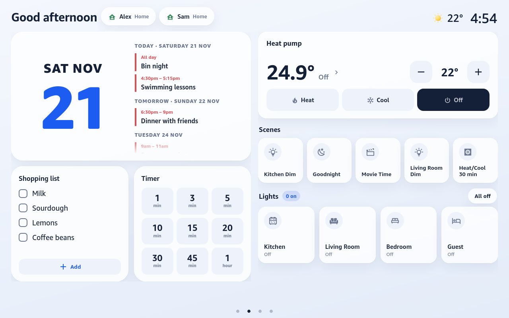
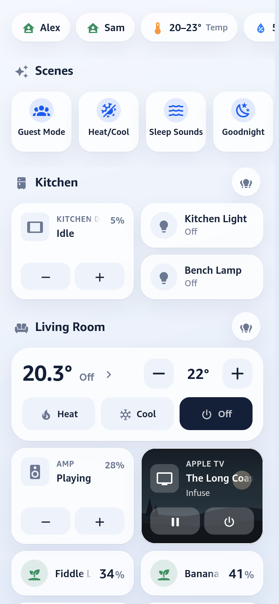

# The Show dashboards

Every dashboard here is the Show design: an Echo Show-style look drawn by one Lit card,
`www/overlook-show.js`. The classic button-card dashboards (ha-kitchen, ha-phone, ha-tablet,
ha-computer, ha-bedroom, ha-homey) were retired on 2026-11-08: removed from HA and from this
repo. Their code is in git history before that date if anything ever needs digging out.

<p>
  
  
</p>

More screenshots in the [README](../README.md).

## What lives where

| file | what it is |
|---|---|
| `www/overlook-show.js` | the source: the Show card and the Meridian cards in one file |
| `www/tablet.js` | the Kitchen Show's pages (Home, Rooms, Climate, Media, Recipes) and their CSS, all under `.tablet`; imported by `overlook-show.js` |
| `www/weather.js` | the weather pop-up, imported by `overlook-show.js`: any tap on a `weather.*` entity without a pop-up of its own opens it (Kitchen Show Outside tile, Echo weather tiles; a status entry with `weather: true` makes a weather pill). Also the full-screen warning alert: room-screen option `warnings: true`, raised by `input_boolean.weather_warning_alert` (automation `weather_warning_notify`), Got it clears it everywhere, hidden in a dark room. And the morning forecast: option `morning: true`, raised by `input_boolean.morning_forecast` (automation `weather_morning_forecast`, 6 to 10 am while someone's home; `morning: {always: true}` shows it regardless and drops Close, used by the hidden `kitchen-weather/weather` and `echo-weather/weather` dashboards, the KS morning screensavers; `morning: {always: true, sky: true}` draws the animated sky behind it from `www/sky.js`, the `<meridian-sky>` element, picking sunny/partly/cloudy/rain/storm/fog/windy/cold/frost/heat/smoke from the BoM descriptor and temperatures): today's high and low, rain, UV, wind and the day's temperatures. Data: the BoM integration and `sensor.rain_next_hour` |
| `dist/meridian.js` | Meridian cards, built from the source by `deploy.py`; what HACS installs. Commit it |
| `www/lit-all.min.js` | Lit, vendored (no CDN) |
| `www/weather-page.js` | `meridian-weather`, the full weather page on the Weather dashboard (`ha-weather`, in the sidebar; the iPhone weather widget opens it): next-hour rain, hourly with Conditions/Rain/Wind, 8 days, RainViewer radar over Esri's dark grey map, detail tiles. Away from home (the viewer's HA person more than 50 km from zone.home) it shows Open-Meteo for where they are, named from the phone's geocoded-location sensor. Hides HA's header (back while editing) and has its own menu button. Imported by `overlook-show.js` |
| `www/weather/*.svg` | weather icons, drawn by `tools/weather_icons.py` (edit that, not the SVGs) |
| `www/fonts/ember.css` | `@font-face` rules for Amazon Ember. The font files live only on HA in `/config/www/fonts/amazon-ember/` (README, Fonts). The card loads the same faces itself (`FONT_FACES`) |
| `show.py` | Kitchen Show (`ha-show`): `VERSION`, and `CARD`: rooms, scenes, status pills, calendars, recipes, and the tablet's own keys (`tablet_tv`, `tablet_players`, `tablet_quick`, `scheme`) |
| `showphone.py` | the phone's data, no dashboard of its own: rooms and scenes (`ROOMS`, `SCENES`), the reading pills (`STATUS_AIR`), the pop-ups (`POPUPS`) and which tap opens which (`LINKS`). `show.py` reads it |
| `dashboards/*.json` | the Phone Show, Computer Show, Master Bedroom Echo Show, Weather and Boox, edited in HA's own editor, as HA holds them. Never edit these here: change HA, then pull |
| `tools/live_sync.py` | keeps the repo and HA in lock step (below) |
| `tools/norish_sync.py` | copies Norish recipes into HA every 30 min (systemd timer on luna) |
| `tools/ha/norish_fav.py` | the recipe heart button, runs on HA |
| `tools/ha/norish_plan.py` | writes the Norish meal plan to `/config/www/norish/plan.json` for the Home and Recipes pages; runs on HA |
| `tools/ha/plex_art.py` | fetches Plex's background and logo for what the Apple TV plays into `/config/www/nowplaying/` (`shell_command.plex_art`); runs on HA |
| `tools/docshots/shoot.py` | the README screenshots, from the live dashboards in headless Firefox; `scrub.js` swaps in a made-up household before the page draws. `HA_HOST=… python3 tools/docshots/shoot.py [kitchen echo computer phone]` |

The Show card has one full-screen layout, the Kitchen Show's pages in `www/tablet.js`. Every
other dashboard is built from Meridian cards in HA's editor, from the same JS file.

**Kitchen Show config keys** (`show.CARD`):
- `tablet_quick`: the Home page's Scenes, in order. Only `scene.` and `script.` entries show;
  each is `{entity, name, icon}`. The kitchen timer has its own card beside the shopping list.
- `tablet_players`: the Media page's speakers, down its right side; tap one to control it.
  `volume` sends volume to another entity (the Apple TV's goes to the amp); `follows` makes a
  player on its TV input count as playing only while the one it follows is.
- `tablet_tv`: the player whose Plex art and episode names the Media page's now-playing card uses.
- `climate`: the heat pump on the Home page. `rooms[].group` (or a room's only light) gives Home its
  light tiles; `status` people and alerts give the header bubbles.
- `scheme`: `sun.sun` switches light and dark with sunrise and sunset.
- `swipe`: a list of page ids (`["media", "home", "rooms", "recipes"]`) drops the dock. The
  pages sit side by side and a sideways drag moves between them, with dots along the bottom.
  A drag that starts on a row that scrolls sideways (the playlists, the recipe shelf) scrolls
  that row. A page that isn't in the list (a voice "show me the climate") opens the one that
  holds it: climate and controls go to Rooms, music to Media, anything else to Home.
  An up-and-down drag the browser doesn't scroll by itself (the tablet's WebView only did so
  from the gaps between tiles) is scrolled, and flung, by the card.
  Everything on a page is `touch-action: pan-y` except the sideways rows: touch-action only
  reaches down to the nearest scroll container, so without it a swipe starting on a column that
  scrolls (Rooms' lights) went to the browser, which cancelled it.
- Rooms with `swipe`: lights and scenes on the left; on the right, one now-playing tile (the
  room's playing speaker, else one with something queued; the Nest Hub showing this dashboard
  doesn't count), then Climate, then Plugs & plants as rows.
- `ks_timers` (a Kiosk Satellite ESPHome node, e.g. `ks_kitchen_display`): Main's timer presets start the kiosk's own timers instead of `timer.<clock>_timer`. The kitchen uses it.
- `photo_clock`: when idle, the slideshow at full brightness with the weather and clock in the top right corner, the day and date ("Friday 13") under them, then the next event
  (darkened). A new photo fades in over the last. A tap goes back to Home.
- `night` (an input_boolean; the kitchen uses `input_boolean.bedroom_night_mode`, 9pm-7:30am
  while someone's home): while it's on, idle shows the Echo's red clock on black instead. A tap
  goes to Home and it returns to the red clock after 30 seconds.

## Changing one

1. **Layout, entities, scenes, pills, pop-ups:** edit the dashboard's Python file.
   **How it looks or behaves:** edit `www/overlook-show.js`.
2. **Bump the version in both places**, to the same number:
   - `VERSION` in `show.py`
   - `const VERSION` near the top of `www/overlook-show.js`

   Skip this and browsers keep the old JS cached, so the change looks like it didn't work.
3. Deploy:
   ```sh
   ./deploy.py show
   ```
   This builds the Show card (and `dist/meridian.js` for HACS), copies the card and
   artwork to `/config/www` over SSH, points the resource at the new
   version and rewrites the Kitchen Show. ha-show holds no UI edits, so its config
   lives in the Python. Run `python3 tools/live_sync.py` first: if HA's ha-show has a change
   the Python lacks, deploy would undo it.
4. **Reload the devices that keep the page open.** The Echo needs its View Assist Companion
   app restarted (`docs/tasks/echo-show-bedroom.md`). The Kitchen Display (Kiosk Satellite) reloads with `button.kitchen_display_restart_app`.
5. Check **every** dashboard, even if you only meant to change one. They share the file:
   - Kitchen Show `/ha-show/show` at 1280x800 and 1024x600 (the compact layout), every page
   - Master Bedroom Echo Show `/master-bedroom-echo-show/controls` at 788x394, every view (since 0.33.0 it swipes between views with page dots, no dock) (Meridian screen cards, edited in HA, not by deploy.py)
   - Computer Show `/ha-show-computer/home` at 1920x1080, sidebar open (Meridian cards, edited in HA, not by deploy.py)
   - Phone Show `/ha-show-native/home` at 390 wide

## Phone Show: native HA cards

`ha-show-native` is the Phone Show built so HA's own editor works on it. Cameron signed it
off on 2026-11-04.

- **Home** is an HA sections view built from **Meridian cards**, installed from HACS
  (`dist/meridian.js`). Every tile is its own card: `meridian-tile` (an
  entity; it picks light / switch / speaker / heat pump / plant / reading / scene from
  the domain, or `kind:` says), `meridian-heading` (room name, icon, all-lights `group`),
  `meridian-scenes` (the scene row), `meridian-status` (the pills), `meridian-favourites`
  (a 4-wide grid of scene-sized squares filled from HA's `usage_prediction/common_control`,
  per signed-in user, re-asked every 10 minutes; on things first, order fixed between fetches so
  nothing jumps under a finger; `pinned` / `hidden` / `count`). They draw with the
  same markup and CSS as the Show card, so they look the same. The old `overlook-*` names
  still work as aliases.
- **One view, no tabs.** The last section is **`meridian-edit-button`**: it hides HA's header
  and puts an Edit dashboard button at the bottom; HA's header comes back with Done. While
  any of the cards above are on screen it also sets HA's grid to the design's sizes (62px
  rows, 10px gaps, 16px sides). A tile is one row, a player two.
- Light sheets and pop-ups open in one layer on `<body>` (`meridian-overlay`). Each card
  carries its own pop-up (`popup:` on a tile, on each status pill and reading), edited in
  HA's card editor: title, icon, then sections (player, tiles, choices, graph, graph of
  several). Tiles, Scenes and Status have full UI editors; no YAML needed.
- Its layout is edited in HA only; `dashboards/ha-show-native.json` is the repo's copy
  (see Lock step). The old generator, `shownative.py`, was retired on 2026-11-15.
- **Shipping a card change:** `deploy.py` rebuilds `dist/meridian.js`; commit and push it,
  then update Meridian cards in HACS. The Show screens' card goes straight to `/config/www`
  and never registers the Meridian cards, so the two can't clash.

## Boox dashboard

`boox-ink` is for the Boox Go 6 e-reader's HA app: plain HA button cards in 3-wide square
grids (Now, Scenes, then one section per room), no Meridian cards, because the e-ink screen
and its slow WebView want something light. Its view theme is **Meridian Ink**
(`themes/meridian-ink.yaml`): white ground, 2px black outlines, no shadows, on = black icon,
off = grey. Picking Meridian Ink as the profile theme on the Boox turns HA's header white too.
It signs in as the `boox` user, whose default dashboard (Profile → Appearance, stored per
account) is set to Boox; everyone else falls through to the system default, ha-show-native. Edited in HA's editor and pulled like the others.

## Lock step

The repo and the live HA are meant to match at all times:

```sh
python3 tools/live_sync.py          # check: lists every difference, exits 1 if any
python3 tools/live_sync.py pull     # copy HA-side edits into the repo, then check
```

It covers the HA-edited dashboards (`dashboards/`), the Kitchen Show against `show.py`, every
automation and script in `ha_config/` (scripts in `ha_config/scripts/`), the helpers
(`helpers.json`), the template helpers (`template_helpers.json`, Pip's in `pip/templates.py`),
`configuration.yaml` (ids masked), the Meridian themes, `tools/ha/*.py` against
`/config/scripts`, and the two card files (the `overlook-show.js` version and HACS's `meridian.js`).

Nothing else is installed for the screens: since 2026-11-15 HA loads only Meridian, the Show
card, the Ember stylesheet and album_slideshow's own card. The old HACS cards, card-mod,
button-card, stack-in-card, View Assist and the Mushroom and Google themes were removed
(backup on HA in `/config/cleanup-backup-2026-11-15`). After any
change in HA, pull and commit; after any change here, deploy, then check. Pull never writes
`show.py`: a live Kitchen Show change has to be put into the Python by hand.

## Adding things

- **A status pill:** add to `CARD["status"]` in `show.py`. Either
  `{entity, name, person}` or `{entity, name, icon, tone, when, toggle}`. `tone` is
  `warn` / `bad` / `cool` / `accent`. `when` = only show while in that state.
- **A phone pop-up:** add a sheet to `POPUPS` in `showphone.py`. Its sections are `tiles`,
  `choices`, `player`, `graph` (one entity) or `multigraph` (several `series`, each with its own
  colour, or one averaged line with `average: true`; `valid: [min, max]` drops impossible readings). Then add `LINKS[entity] = "<popup id>"` so tapping that
  entity opens it. Anything without a link opens HA's normal more-info.
- **A weather icon:** edit `tools/weather_icons.py`, run it, and bump the `?v=` on the icon
  URL in `_wxIcon` so screens fetch the new files.

## Using it

- **Lights:** tap = on/off. Hold a phone light tile, or tap ⋮ on a tablet light pill, and the
  light sheet opens: brightness pill, power, warm/cool white bar, 8 colour swatches (only on
  bulbs that do colour), and for groups each bulb with its own on/off. ⋯ in the corner opens
  HA's standard dialog.
- **Get back to normal HA (edit mode, sidebar):** hold the clock 1.5 s on the tablet.
- **Idle:** the Kitchen Display's idle is Kiosk Satellite's screensaver since 2026-11-21 (the `kitchen-weather` dashboard 5:30-8am, Immich photos to 9pm, then the clock, with split Now Playing; set in KS, not show.py). `idle`/`photos` still drive the Echo-style photo page on screens that set them. Not while a recipe is open: with swiping, idle brings the open recipe back instead, and swiping away keeps it open.
  A tap on the photos goes back to Home.
- **Phone haptics** come from the HA companion app (the `haptic` event), so they only work
  inside the app, not in Safari.

## Security pill

A `status` entry with `security: true` (the kitchen in `show.py`, the phone and computer Shows
in their live config) is always shown. Its entity is the `binary_sensor.doors_and_windows` group;
the pill is green while every member is shut and `input_boolean.inspection_mode` is off, and
orange otherwise, with "n open" (or "Inspection") beside the name. Its pop-up is built in
`www/tablet.js` (`securityPopup` / `secSection`), not stored in the config: inspection mode while
on, both Frigate camera feeds (`/api/camera_proxy_stream`), then what is open. A new door or window
sensor only has to join the group. `security:` can also be an object that overrides `cameras` or
`mode`.

On the Kitchen Display the same entry adds a **Security** chip after the rooms on the Rooms page
(`securityRoom` in `www/tablet.js`): every door and window as scene-sized squares (orange when
open), then each camera as a light-sized square with its live picture; tapping a camera opens it
big in a pop-up (`openCam`, pop-up section type `camera`).

## Traps

- HA's history API returns **one day** unless you pass `end_time`. Graphs that stop short are
  this, not the recorder.
- Lights and heat pump are in use at home: when testing, stub service calls
  (`card._call = ...`) instead of really tapping.
- **A cast loads the page from cast.home-assistant.io.** Any `/local/...` or `/api/...` path
  must go through `this._u()` (makes it absolute with `hass.hassUrl`), or it points at
  Google's server and the image comes up blank.
- Under 680px tall the compact layout kicks in; the heat pump card is the tightest fit.
- **The timer and alarm digits are sized from the font's widths** (`_ckFit`: Ember Display
  800 digits are 0.6em, colons 0.31em). Change the display font and those numbers must change.
- The amp's inputs (`INPUTS`) show an icon on a light accent tint instead of artwork.
- **Screenshots for this public repo use placeholders.** The calendar, shopping list and photo
  are faked in the page before capture, and HA's sidebar is cropped off (it shows the
  signed-in user's picture).
