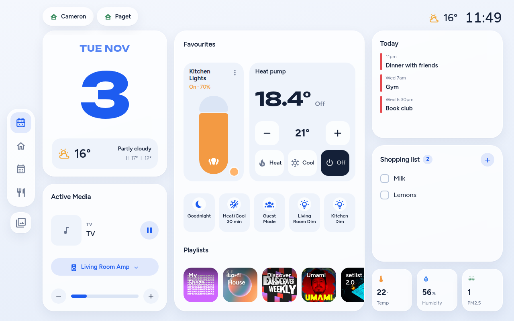
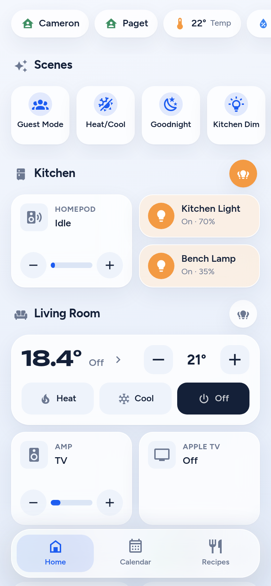

# The two kinds of dashboard

This repo builds two families of Home Assistant dashboard. They live side by side on
purpose (Cameron, 2026-11-03: "keep both"). They share the repo, the theme and
`deploy.py`, and **nothing else**. Changing one never changes the other.

| | **Classic** | **Show** |
|---|---|---|
| Look | Overlook tiles, Bubble Card pop-ups | Echo Show style, bottom-sheet pop-ups |
| Built with | `custom:button-card` + Bubble Card | one Lit card, `www/overlook-show.js` |
| Dashboards | ha-phone, ha-tablet, ha-computer, ha-kitchen, ha-bedroom (+ ha-homey test) | ha-show (Kitchen Show), ha-show-phone (Phone Show) |
| Python | `design.py`, `patch3.py`, `scenes.py`, `roomscreen.py`, one module each | `show.py`, `showphone.py` |
| Hand-edited in the HA UI? | **Yes.** Cameron moves cards around | No. The UI only sees one card |
| Safe way to change | `--patch` (keeps his edits) | plain deploy |

---

## Classic dashboards

### What lives where

| file | what it is |
|---|---|
| `design.py` | every card builder, the palette, the colour logic. Not house-specific |
| `scenes.py` | the one scene list all of them use |
| `patch3.py` | the status pills, all the `#ov-*` Bubble Card pop-ups, and the patcher |
| `phone.py` `tablet.py` `computer.py` | layouts |
| `kitchen.py` `bedroom.py` → `roomscreen.py` | the two room screens (Nest Hub, Echo Show 5) |
| `homey_lights.py` | "Homey lights test": a copy of the live phone with Homey-style lights |

### Changing one

1. **Assume Cameron has edited it.** Read the live config first:
   `./deploy.py --dry-run phone` builds it and diffs against what's live.
2. Change the generator (`phone.py`, `design.py` etc).
3. Deploy with **`--patch`**:
   ```sh
   ./deploy.py --patch phone
   ```
   It swaps only the cards this repo owns and refuses to write if anything else moved.
   If it refuses, he changed that card. Keep his version and bring the generator into line.
4. Check it on the phone (390 wide), tablet (1280x800) or computer (1440x820 and 1920x950).

**Never run a plain `./deploy.py phone` (no `--patch`) on a classic dashboard.** It replaces
the whole dashboard and throws away anything rearranged in the UI. The one exception is a
dashboard that is brand new and hasn't been touched by hand.

### Adding a pop-up

Add it in `patch3.py` (`design.info_popup(hash, ...)`), then point a tile's `tap_action` at
`#<hash>`. Check both halves exist: a pop-up nothing links to is dead, and so is a link
with no pop-up.

### Traps

- card-mod does nothing on HA 2026.10. Style with button-card's `styles` / `extra_styles`.
- button-card can't draw a slider, dropdown or stepper. That's what the pop-ups are for.
- Media cards span two grid rows (`grid_options: {columns: 6, rows: 2}`) so tiles pack round them.
- Never wrap cards in a `conditional`/`grid` to switch them together. Use per-card
  `visibility`, or the cards can't be dragged.

More detail: `AGENTS.md` (general) and `docs/LIVE.md` (this house).

---

## Show dashboards

<p>
  
  
</p>

More screenshots in the [README](../README.md#the-show-dashboards).

### What lives where

| file | what it is |
|---|---|
| `www/overlook-show.js` | the whole UI: one Lit card, tablet and phone layouts in one file |
| `www/lit-all.min.js` | Lit, vendored (no CDN) |
| `show.py` | Kitchen Show: `VERSION`, the card's config (`CARD`): rooms, scenes, status pills, calendar, recipes |
| `showphone.py` | Phone Show: `show.CARD` plus `phone: True`, ha-phone's rooms and scenes, the pop-ups (`POPUPS`) and which tap opens which (`LINKS`) |
| `tools/norish_sync.py` | copies Norish recipes into HA every 30 min (systemd timer on luna) |
| `tools/ha/norish_fav.py` | the recipe heart button, runs on HA |

Both dashboards run the **same JS file**. `phone: true` in the config switches it to the
phone layout. All phone-only CSS sits under `.phone`.

### Changing one

1. **Layout, entities, scenes, pills, pop-ups:** edit `show.py` or `showphone.py`.
   **How it looks or behaves:** edit `www/overlook-show.js`.
2. **Bump the version in both places**, to the same number:
   - `VERSION` in `show.py`
   - `const VERSION` near the top of `www/overlook-show.js`

   Skip this and browsers keep the old JS cached, so the change looks like it didn't work.
3. Deploy:
   ```sh
   ./deploy.py show showphone
   ```
   This copies the JS to `/config/www` over SSH, points the resource at the new version and
   rewrites both dashboards. Edits Cameron made on the phone are kept: deploy compares each
   card key with what it last deployed (`.deployed/`, not in git) and leaves anything that
   changed live alone. If the Python changed the same key it says `ALSO CHANGED HERE` -
   merge that one by hand from the live config.
4. Check **both** dashboards, even if you only meant to change one. They share the file:
   - Kitchen Show `/ha-show/show` at 1280x800 (the ALLDOCUBE tablet)
   - Phone Show `/ha-show-phone/phone` at 390 wide

### Adding things

- **A status pill:** add to `CARD["status"]` in `show.py`. Either
  `{entity, name, person}` or `{entity, name, icon, tone, when, toggle}`. `tone` is
  `warn` / `bad` / `cool` / `accent`. `when` = only show while in that state.
- **A phone pop-up:** add a sheet to `POPUPS` in `showphone.py`. Its sections are `tiles`,
  `choices`, `player` or `graph`. Then add `LINKS[entity] = "<popup id>"` so tapping that
  entity opens it. Anything without a link opens HA's normal more-info.
- **A phone room or tile:** Cameron does these himself now, in edit mode (below). `ROOMS` and
  `SCENES` in `showphone.py` are only the starting layout; once he saves on the phone the
  live `phone_rooms` / `scenes` win. Tile types: `light`, `media`, `climate`, `switch`,
  `plant`, `sensor`, `scene`.
- **The reading pills** (`status_air`) cover the house: each lists `sources`, every room's
  sensor (plus the heat pump's own temperature and humidity), and shows low-high.

### Using it

- **Lights:** tap = on/off. Hold a phone light tile, or tap ⋮ on a tablet light pill, and our
  own light sheet opens: brightness pill, power, warm/cool white bar, 8 colour swatches
  (only on bulbs that do colour), and for groups each bulb with its own on/off. ⋯ in the
  corner opens HA's standard dialog (settings, history, effects).

- **Edit the phone Home (admins):** hold the Home tab 1 s. Hold a tile and drag to move it
  (between rooms too), tap it to rename, change its icon or room, the minus to remove it, `+ Add`
  to pick any entity. The pencil on a room renames, reorders or removes it, or sets its
  all-lights button. Save writes the dashboard config; Cancel drops it. Pills and pop-ups
  aren't in edit mode - `HA editor` in the edit bar uncovers HA's own (YAML) editor.
- **Get back to normal HA on the tablet:** hold the clock 1.5 s.
- **Tablet idle:** after 5 minutes it goes to the photo slideshow (not while a recipe is open).
- **Phone haptics** come from the HA companion app (the `haptic` event), so they only work
  inside the app, not in Safari.

### Traps

- HA's history API returns **one day** unless you pass `end_time`. Graphs that stop
  short are this, not the recorder.
- Lights and heat pump are in use at home: when testing, stub service calls
  (`card._call = ...`) instead of really tapping.
- **Kitchen Show runs on the Nest Hub** (1024x600, cast) since 2026-11-03, and will move to the
  ALLDOCUBE tablet when it arrives. Check every change at **1024x600** as well as 1280x800:
  under 680px tall the compact layout kicks in, and the heat pump card is the tightest fit.
- **A cast loads the page from cast.home-assistant.io.** Any `/local/...` or `/api/...` path
  must go through `this._u()` (makes it absolute with `hass.hassUrl`), or it points at
  Google's server and the image comes up blank.
- Phone Show is **not signed off** yet.

---

## Retiring one later

When one family wins, delete the other entirely. Don't keep it around as a fallback:
1. Remove its dashboards in HA (Settings → Dashboards).
2. Delete its files and its lines in `deploy.py`'s `TARGETS`.
3. Update this file, `README.md` and `docs/LIVE.md`.

Ask Cameron first. The classic dashboards hold his hand edits.
