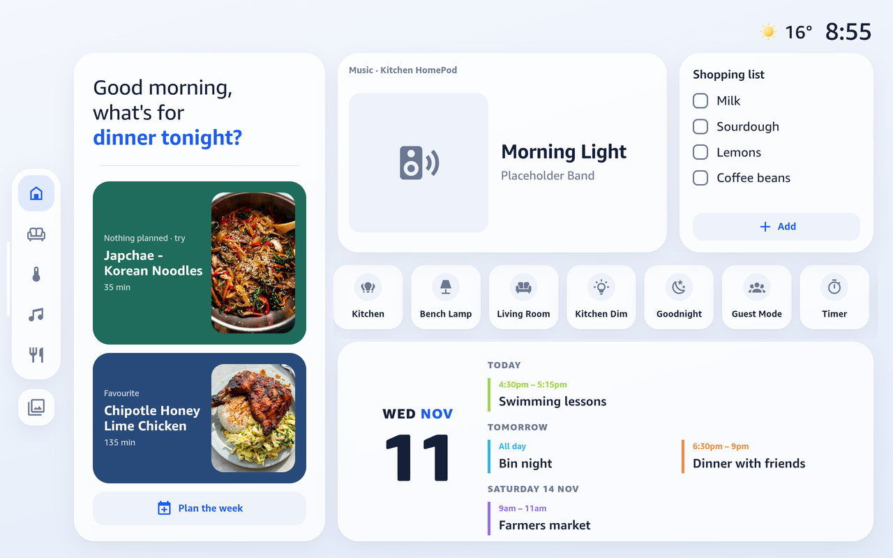

# The Show dashboards

Every dashboard here is the Show design: an Echo Show-style look drawn by one Lit card,
`www/overlook-show.js`. The classic button-card dashboards (ha-kitchen, ha-phone, ha-tablet,
ha-computer, ha-bedroom, ha-homey) were retired on 2026-11-08: removed from HA and from this
repo. Their code is in git history before that date if anything ever needs digging out.

<p>
  
  
</p>

More screenshots in the [README](../README.md).

## What lives where

| file | what it is |
|---|---|
| `www/overlook-show.js` | the source: the Show card and the Meridian cards in one file |
| `www/tablet.js` | the Kitchen Show's pages (Home, Rooms, Climate, Media, Recipes) and their CSS, all under `.tablet`; imported by `overlook-show.js` |
| `dist/meridian.js` | Meridian cards, built from the source by `deploy.py`; what HACS installs. Commit it |
| `www/lit-all.min.js` | Lit, vendored (no CDN) |
| `www/weather/*.svg` | weather icons, drawn by `tools/weather_icons.py` (edit that, not the SVGs) |
| `www/fonts/ember.css` | `@font-face` rules for Amazon Ember. The font files live only on HA in `/config/www/fonts/amazon-ember/` (README, Fonts). The card loads the same faces itself (`FONT_FACES`) |
| `show.py` | Kitchen Show (`ha-show`): `VERSION`, and `CARD`: rooms, scenes, status pills, calendars, recipes, and the tablet's own keys (`tablet_tv`, `tablet_players`, `tablet_quick`, `scheme`) |
| `showphone.py` | the phone's data, no dashboard of its own: rooms and scenes (`ROOMS`, `SCENES`), the reading pills (`STATUS_AIR`), the pop-ups (`POPUPS`) and which tap opens which (`LINKS`). `shownative.py` reads it |
| `shownative.py` | Phone Show (`ha-show-native`): the same rooms, scenes and pop-ups as ordinary HA cards in a sections view (see below) |
| `tools/norish_sync.py` | copies Norish recipes into HA every 30 min (systemd timer on luna) |
| `tools/ha/norish_fav.py` | the recipe heart button, runs on HA |
| `tools/ha/norish_plan.py` | writes the Norish meal plan to `/config/www/norish/plan.json` for the Home and Recipes pages; runs on HA |
| `tools/ha/plex_art.py` | fetches Plex's background and logo for what the Apple TV plays into `/config/www/nowplaying/` (`shell_command.plex_art`); runs on HA |

The Show card has one full-screen layout, the Kitchen Show's pages in `www/tablet.js`. Every
other dashboard is built from Meridian cards in HA's editor, from the same JS file.

**Kitchen Show config keys** (`show.CARD`):
- `tablet_quick`: the Home page's quick actions, in order, scrolling sideways seven at a time.
  Each is `{entity, name, icon}`; `{timer: true}` puts the kitchen timer there.
- `tablet_players`: the Media page's speakers. `volume` sends volume to another entity (the
  Apple TV's goes to the amp); `follows` hides a player while the one it follows is on.
- `tablet_tv`: the player whose Plex art fills the Home page's TV tile.
- `scheme`: `sun.sun` switches light and dark with sunrise and sunset.
- `swipe`: a list of page ids (`["media", "home", "rooms", "recipes"]`) drops the dock. The
  pages sit side by side and a sideways drag moves between them, with dots along the bottom.
  A drag that starts on a row that scrolls sideways (the quick actions, the recipe shelf) scrolls
  that row. A page that isn't in the list (a voice "show me the climate") opens the one that
  holds it: climate and controls go to Rooms, music to Media, anything else to Home.
  An up-and-down drag the browser doesn't scroll by itself (the tablet's WebView only did so
  from the gaps between tiles) is scrolled, and flung, by the card.
  Everything on a page is `touch-action: pan-y` except the sideways rows: touch-action only
  reaches down to the nearest scroll container, so without it a swipe starting on a column that
  scrolls (Rooms' lights) went to the browser, which cancelled it.
- Rooms with `swipe`: lights and scenes on the left; on the right, one now-playing tile (the
  room's playing speaker, else one with something queued; the Nest Hub showing this dashboard
  doesn't count), then Climate, then Plugs & plants as rows.
- `photo_clock`: when idle, the slideshow at full brightness with the weather and clock in the top right corner, the day and date ("Friday 13") under them, then the next event
  (darkened). A new photo fades in over the last. A tap goes back to Home.
- `night` (an input_boolean; the kitchen uses `input_boolean.bedroom_night_mode`, 9pm-7:30am
  while someone's home): while it's on, idle shows the Echo's red clock on black instead. A tap
  goes to Home and it returns to the red clock after 30 seconds.

## Changing one

1. **Layout, entities, scenes, pills, pop-ups:** edit the dashboard's Python file.
   **How it looks or behaves:** edit `www/overlook-show.js`.
2. **Bump the version in both places**, to the same number:
   - `VERSION` in `show.py`
   - `const VERSION` near the top of `www/overlook-show.js`

   Skip this and browsers keep the old JS cached, so the change looks like it didn't work.
3. Deploy:
   ```sh
   ./deploy.py show shownative
   ```
   This builds the Show card (and `dist/meridian.js` for HACS), copies the card and
   artwork to `/config/www` over SSH, points the resource at the new
   version and rewrites the dashboards. ha-show
   holds no UI edits, so its config lives in the Python; ha-show-native is
   only rewritten while nobody has edited it in HA.
4. **Reload the devices that keep the page open.** The Echo needs its View Assist Companion
   app restarted (`docs/tasks/echo-show-bedroom.md`). The Nest Hub needs the cast dropped and
   started again (`media_player.turn_off`, then `cast.show_lovelace_view`); recasting the same
   view does not reload it.
5. Check **every** dashboard, even if you only meant to change one. They share the file:
   - Kitchen Show `/ha-show/show` at 1280x800 and at 1024x600 (the Nest Hub), every page
   - Master Bedroom Echo Show `/master-bedroom-echo-show/controls` at 788x394, every view (since 0.33.0 it swipes between views with page dots, no dock) (Meridian screen cards, edited in HA, not by deploy.py)
   - Computer Show `/ha-show-computer/home` at 1920x1080, sidebar open (Meridian cards, edited in HA, not by deploy.py)
   - Phone Show `/ha-show-native/home` at 390 wide

## Phone Show: native HA cards

`ha-show-native` is the Phone Show built so HA's own editor works on it. Cameron signed it
off on 2026-11-04.

- **Home** is an HA sections view built from **Meridian cards**, installed from HACS
  (`dist/meridian.js`). Every tile is its own card: `meridian-tile` (an
  entity; it picks light / switch / speaker / heat pump / plant / reading / scene from
  the domain, or `kind:` says), `meridian-heading` (room name, icon, all-lights `group`),
  `meridian-scenes` (the scene row), `meridian-status` (the pills), `meridian-favourites`
  (a 4-wide grid of scene-sized squares filled from HA's `usage_prediction/common_control`,
  per signed-in user, re-asked every 10 minutes; on things first, order fixed between fetches so
  nothing jumps under a finger; `pinned` / `hidden` / `count`). They draw with the
  same markup and CSS as the Show card, so they look the same. The old `overlook-*` names
  still work as aliases.
- **One view, no tabs.** The last section is **`meridian-edit-button`**: it hides HA's header
  and puts an Edit dashboard button at the bottom; HA's header comes back with Done. While
  any of the cards above are on screen it also sets HA's grid to the design's sizes (62px
  rows, 10px gaps, 16px sides). A tile is one row, a player two.
- Light sheets and pop-ups open in one layer on `<body>` (`meridian-overlay`). Each card
  carries its own pop-up (`popup:` on a tile, on each status pill and reading), edited in
  HA's card editor: title, icon, then sections (player, tiles, choices, graph, graph of
  several). Tiles, Scenes and Status have full UI editors; no YAML needed.
- `./deploy.py shownative` writes the layout **only while it is unedited** (snapshot in
  `.deployed/`, gitignored). Once it has been changed in HA, deploy keeps HA's version.
- **Shipping a card change:** `deploy.py` rebuilds `dist/meridian.js`; commit and push it,
  then update Meridian cards in HACS. The Show screens' card goes straight to `/config/www`
  and never registers the Meridian cards, so the two can't clash.

## Adding things

- **A status pill:** add to `CARD["status"]` in `show.py`. Either
  `{entity, name, person}` or `{entity, name, icon, tone, when, toggle}`. `tone` is
  `warn` / `bad` / `cool` / `accent`. `when` = only show while in that state.
- **A phone pop-up:** add a sheet to `POPUPS` in `showphone.py`. Its sections are `tiles`,
  `choices`, `player`, `graph` (one entity) or `multigraph` (several `series`, each with its own
  colour, or one averaged line with `average: true`; `valid: [min, max]` drops impossible readings). Then add `LINKS[entity] = "<popup id>"` so tapping that
  entity opens it. Anything without a link opens HA's normal more-info.
- **A weather icon:** edit `tools/weather_icons.py`, run it, and bump the `?v=` on the icon
  URL in `_wxIcon` so screens fetch the new files.

## Using it

- **Lights:** tap = on/off. Hold a phone light tile, or tap ⋮ on a tablet light pill, and the
  light sheet opens: brightness pill, power, warm/cool white bar, 8 colour swatches (only on
  bulbs that do colour), and for groups each bulb with its own on/off. ⋯ in the corner opens
  HA's standard dialog.
- **Get back to normal HA (edit mode, sidebar):** hold the clock 1.5 s on the tablet.
- **Idle:** the tablet and Hub go to photos after 90 seconds (`idle` in show.py; the Echo has its own). Not while a recipe is open: with swiping, idle brings the open recipe back instead, and swiping away keeps it open.
  A tap on the photos goes back to Home.
- **Phone haptics** come from the HA companion app (the `haptic` event), so they only work
  inside the app, not in Safari.

## Traps

- HA's history API returns **one day** unless you pass `end_time`. Graphs that stop short are
  this, not the recorder.
- Lights and heat pump are in use at home: when testing, stub service calls
  (`card._call = ...`) instead of really tapping.
- **A cast loads the page from cast.home-assistant.io.** Any `/local/...` or `/api/...` path
  must go through `this._u()` (makes it absolute with `hass.hassUrl`), or it points at
  Google's server and the image comes up blank.
- Under 680px tall the compact layout kicks in; the heat pump card is the tightest fit.
- **The timer and alarm digits are sized from the font's widths** (`_ckFit`: Ember Display
  800 digits are 0.6em, colons 0.31em). Change the display font and those numbers must change.
- The amp's inputs (`INPUTS`) show an icon on a light accent tint instead of artwork.
- **Screenshots for this public repo use placeholders.** The calendar, shopping list and photo
  are faked in the page before capture, and HA's sidebar is cropped off (it shows the
  signed-in user's picture).
